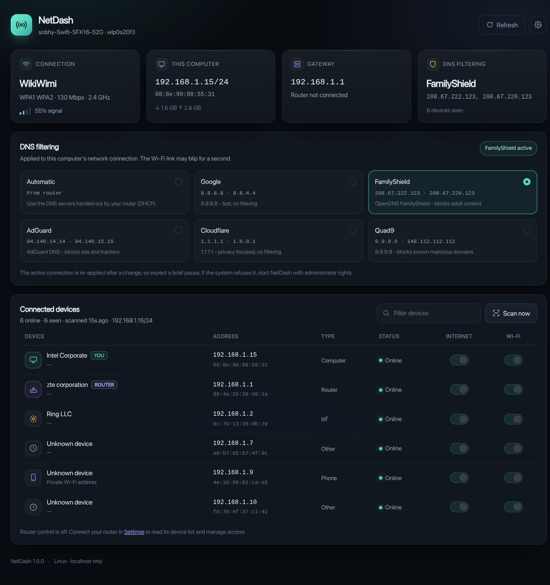

# NetDash

A small, local network dashboard for Linux and Windows. It shows your current
connection, lists the devices on your LAN, and switches your system DNS with one
click.

No third-party packages, no cloud service, no telemetry. Just Python 3 and your
browser.



## Quick start

```bash
# Linux
python3 app.py

# Windows
py -3 app.py
```

The dashboard opens at <http://127.0.0.1:8765/>. The server binds to localhost
only.

Options:

```bash
python3 app.py --port 9000     # use another port
python3 app.py --no-browser    # do not open a browser
```

Requires Python 3.10 or newer. Everything else is part of the standard library.

## What it does

| Area | Details |
| --- | --- |
| Connection | SSID, security, signal strength, link rate, channel, interface, MAC, local IP |
| Traffic | Total received/sent bytes for the active interface |
| Devices | Ping sweep + ARP/neighbour table, vendor lookup from the bundled IEEE OUI registry, best-effort hostnames |
| Labels | Custom device names keyed to the MAC address, stored locally |
| Sorting | Sort the table by Device, Address, Type, or Status; click again to reverse |
| DNS | Switch between Automatic (DHCP), Google, FamilyShield, AdGuard, Cloudflare Malware and Cloudflare Family |
| Speed test | Ping/jitter, download and upload against Cloudflare's public speed endpoints |
| Router | Optional ZTE login, model detection, router-side client list |
| Device access | Per-device **Internet** switch written to the router (Wi-Fi where the firmware allows it) |
| Packaging | One Python process, one HTML/CSS/JS page, works offline |

## Device labels

Labels appear as a badge next to the real device name, styled like the `YOU`
and `ROUTER` tags. The hostname itself stays read-only.

Click the pencil that appears on hover (or is always visible on touch screens)
to add or change a label. Press **Enter** to save, **Esc** to cancel, or save an
empty value to clear it.

Labels are keyed to the normalized MAC address and stored in
`~/.config/netdash/config.json`, so they survive IP changes and restarts. They
are local to NetDash and are never written to the router. The search box matches
labels too.

## DNS profiles

| Profile | Servers |
| --- | --- |
| Automatic | cleared, uses the router's DHCP values |
| Google | 8.8.8.8, 8.8.4.4 |
| FamilyShield | 208.67.222.123, 208.67.220.123 |
| AdGuard | 94.140.14.14, 94.140.15.15 |
| Cloudflare Malware | 1.1.1.2, 1.0.0.2 |
| Cloudflare Family | 1.1.1.3, 1.0.0.3 |

The app applies DNS through NetworkManager (`nmcli`) on Linux and `netsh` on
Windows. The connection is re-applied, so expect a one-second blip.

Changing DNS needs administrator rights:

- **Linux:** start the app with `sudo python3 app.py`, or let your desktop's
  PolicyKit prompt appear (works on most Mint/Ubuntu setups).
- **Windows:** run the terminal as Administrator.

The current DNS servers are read back after the change, so the UI only reports
success when the setting actually took effect.

## Speed test

Click **Run speed test**. The backend measures TCP latency (5 samples) and
jitter, then a time-capped download and an upload whose size scales with the
measured download rate. Results are shown as ping, download and upload, with
live phase text while it runs.

It uses Cloudflare's public endpoints (`speed.cloudflare.com`), so the test
traffic goes to Cloudflare. Expect roughly 10-30 MB of data and 10-40 seconds
depending on the line. The last result stays in memory until the app restarts.

## Router control

A normal client PC cannot cut another device's traffic by itself; only the
router can. NetDash therefore signs in to the router and uses its own features:

| Switch | Router feature | Effect |
| --- | --- | --- |
| **Internet** | Firewall MAC filter, black-list mode | Blocks routed traffic (internet) for that MAC |
| **Wi-Fi** | WLAN access control, black-list rule | Blocks that MAC from joining the device's SSID — only on firmware that allows editing it |

Each toggle adds or removes exactly one rule for the selected MAC and is
reversible by toggling back. The adapter:

- refuses to touch the filter when the router is in **white-list** mode,
  because flipping it could disconnect every other device;
- never changes the machine running NetDash or the router itself;
- verifies every write by re-reading the router's rule list;
- signs writes with the router's RSA key and the page's session token, the same
  `Check` header the web UI uses.

Tested against the **ZTE F670L** (F670 family). On that firmware, **Internet
blocking works** (the firewall MAC filter accepts writes and is verified). ZTE
disables **WLAN access-control editing** there: the page unbinds its rule Apply
button and the policy endpoint rejects POSTs, so the Wi-Fi switches stay locked.
That is a firmware restriction, not a NetDash choice.

You can confirm both from **Settings → Test router control**: it writes and
removes a rule for a reserved MAC (`02:00:00:00:00:01`) and restores the router's
filter settings afterwards.

Other ZTE firmware may use different page names; those switches stay locked
instead of writing blindly.

If a switch stays locked, run `python3 app.py --diagnose` and inspect
`router-diagnostics.json`. It contains the raw access-control responses (no
passwords) needed to support another firmware variant.

ARP spoofing and Wi-Fi deauthentication would also work, but they are attacks
that break encryption assumptions and can knock devices off networks. NetDash
does not do that.

## Security

- The web server listens on `127.0.0.1` only.
- Every API call needs a random session token that is embedded in the page, and
  the `Host` header is validated. State-changing requests also validate
  `Origin`. This blocks DNS-rebinding and cross-site request forgery from other
  websites.
- Router credentials, if you choose to remember them, are stored in
  `~/.config/netdash/config.json` (`%APPDATA%\NetDash\config.json` on Windows)
  with `0600` permissions. They are never sent back to the browser.
- There is no outbound traffic except the router's local admin page.

## Platform notes

**Linux** uses `ip`, `ping`, `nmcli` and (optionally) `resolvectl`. These are
present on Linux Mint, Ubuntu and most desktop distributions.

**Windows** uses `ipconfig`, `arp -a`, `ping`, `netsh` and PowerShell for
per-interface counters. Run as Administrator for DNS changes. Windows Firewall
may prompt the first time Python listens on a port; NetDash only binds to
loopback, so you can deny the public-network prompt.

## Project layout

```
app.py                     entry point
netdash/
  api.py                   application state + JSON API
  server.py                local HTTP server, token auth, static files
  netinfo.py               connection details (Linux + Windows)
  scanner.py               ping sweep, ARP table, vendor lookup
  dnsman.py                DNS profiles and apply/verify
  router/
    base.py                adapter interface
    zte.py                 ZTE F-series adapter (login, client list)
  static/                  HTML, CSS, vanilla JS
  data/oui.txt             IEEE OUI registry (offline vendor lookup)
```

## Troubleshooting

**"Could not change DNS" / permission error** — run the app as root
(`sudo python3 app.py`) or as Administrator on Windows.

**No devices appear** — some networks isolate clients (AP isolation). The scan
can only see hosts that answer ping or appear in the ARP table.

**Devices show as "phone" with no vendor** — modern phones use randomized,
locally administered MAC addresses, so the vendor cannot be resolved.

**Router login fails** — the address must be the gateway, and the username is
usually `admin`. Repeated wrong attempts make some ZTE routers lock logins for a
few minutes.
